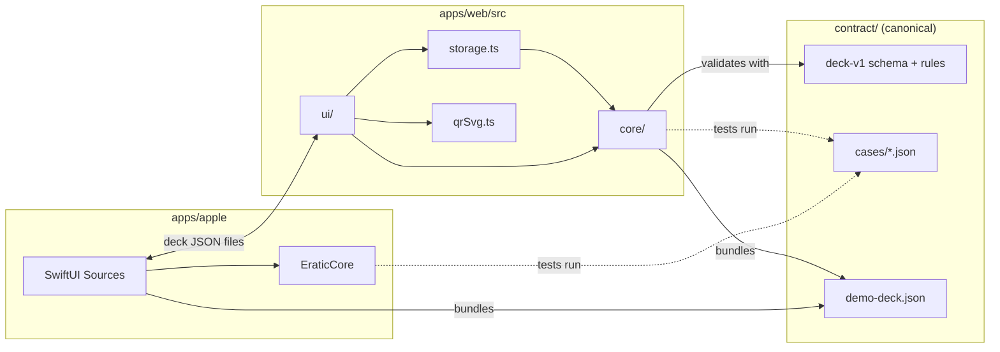

# Architecture

Two independent applications share file formats and rules, not code. A native SwiftUI app serves Mac, iPad, and iPhone. A static React/TypeScript app serves browsers without the Apple app or a backend. Both read and write the versioned deck JSON and the game session files defined in [`contract/`](contract/README.md), both implement the game rules of [`contract/game-rules.md`](contract/game-rules.md), and both prove it by running the same contract cases.

## Components

| Component | Owns | Must not |
| --- | --- | --- |
| `contract/` | The deck-v1 and deck-v2 and session-v1 JSON Schemas, the semantic rules the schemas cannot express, the game rules (`game-rules.md`), era boundaries (`eras.json`), the fictional sample deck, and every case both cores run | Depend on either app |
| `apps/apple/EraticCore` | Swift models, strict JSON-text checks (`StrictJSON`), decoding and encoding, validation, the card URL policy, QR route selection, curation, the game primitives and rules engine (`Random`, `Scoring`, `GameEngine`, `GameModes`, `GameQueries`), session files (`Session`, `SessionCodec`) and scan resolution (`Scan`) | Import SwiftUI or hold UI strings; it is Foundation-only so its tests need no simulator |
| `apps/apple/Sources` | SwiftUI workspace, file import and export dialogs, editing sheets, Core Image QR rendering, display labels, era styling; `Game/` (Play home, setup, host screen, mode inputs, `GameController`, `SessionStore`), `Playback/` (provider adapters, clip timing, calibration) and `Scanner/` (AVFoundation + Vision) | Re-implement deck or game rules; call the core instead |
| `apps/web/src/core` | TypeScript mirror of EraticCore: `deck.ts` (types, byte and text decoding, duplicate-name check, AJV schema check, semantic validation, codec, sample, curation, v2 migration), `cardUrls.ts` (URL policy, QR route), `random.ts`, `eras.ts`, `scoring.ts`, `scan.ts`, `session.ts` and `game/` (rules engine per mode) | Import React or touch the DOM or browser storage; an architecture test enforces this |
| `apps/web/src/storage.ts` | The browser's saved deck in `localStorage` (`qr-song-quiz.deck.v1`), including quarantine of an unreadable saved value | Overwrite saved data it cannot read before a copy is kept under the quarantine key |
| `apps/web/src/qrSvg.ts` | SVG QR rendering with the `qrcode` dependency | Choose or alter payloads |
| `apps/web/src/sessions.ts` | The current game session (`eratic.session.v1`), its deck snapshot and the Daily record (`eratic.daily.v1`) in `localStorage`, with the same quarantine as decks | Overwrite an unreadable saved session |
| `apps/web/src/playback`, `apps/web/src/scanner` | Provider adapters (Spotify Web Playback SDK and Web API, MusicKit JS, manual), clip timing, calibration; camera QR decoding (`BarcodeDetector`, else jsQR) | Hold game rules, or load provider scripts before a connection or explicit preview request |
| `apps/web/src/ui` | React screens, notices, file download and upload, era styling (`eras.ts`, `Wordmark.tsx`); `game/` (Play home, setup, host screen, mode inputs through a registry, the game controller) | Re-implement deck or game rules |
| `design/eras.json` | Presentation tokens for the nine eras (same IDs and order as `contract/eras.json`); read by the web UI, and bundled into the Apple app, where `EraticCore` joins them with the contract's boundaries (`EraTokens.swift`) | Hold deck data, rules or era boundaries |

Dependencies point one way: UI → core → contract. The two cores hold the same concepts in matching places, so a rule change is easy to find in both:

| Concept | Swift (`EraticCore`) | TypeScript (`src/core`) |
| --- | --- | --- |
| Models | `Deck.swift` | `deck.ts` types |
| File bytes and JSON text | `StrictJSON.validate`, `DeckCodec.decode(Data)` | `decodeDeckBytes`, `parseDeck` |
| Validation and export | `DeckCodec.validate`, `DeckCodec.encode` | `validateDeck`, `exportDeck` |
| URL policy | `CardURLPolicy.isSafeHTTPS`, `.isOfficialCardURL` | `isSafeHTTPS`, `isOfficialCardURL` |
| QR route | `QRMode`, `QRRoute.payload` | `QRMode`, `qrPayload` |
| Curation | `Deck.updatingGameYear` | `updateGameYear` |
| Sample deck | bundled resource, loaded by the app | `demoDeck()` |
| Determinism | `Random.swift` (`fnv1a32`, `Mulberry32`, `drawOrder`, `pickAnchors`, `dailySelection`) | `random.ts` |
| Eras | `EraBoundaries.swift` | `eras.ts` |
| Scoring primitives | `Scoring.swift` | `scoring.ts` |
| Rules engine | `GameEngine.swift`, `GameModes.swift`, `GameQueries.swift` | `game/engine.ts`, `game/<mode>.ts` |
| Session files | `Session.swift`, `SessionCodec.swift` | `session.ts` |
| Scan and provider tracks | `Scan.swift` (`ScanRules`) | `scan.ts` |
| Playlist candidates | `Playlist.swift` (`PlaylistRules`) | `playlist.ts` |

## Contract and parity

The JSON Schema is canonical, and `contract/README.md` adds the rules a schema cannot express: duplicate IDs, well-formed strings, and the URL grammar. The rules are written out explicitly rather than delegated to a platform URL parser, because WHATWG `URL` and Foundation `URLComponents` disagree ([ADR 0008](docs/adr/0008-explicit-text-and-url-rules.md)). Both test suites run every file in `contract/cases/`. A rule exists in the contract once it has a case there, and a change lands in the schema, the README, the cases, Swift, and TypeScript together.

Validation is strict. Files must be RFC 8259 JSON in UTF-8 without duplicate member names; unknown fields, unknown versions, and nulls are rejected, so an older application cannot silently drop newer data on export. Stable card IDs belong to the deck. Provider IDs, URLs, and release dates belong to optional links. Editing an answer year or replacing a link never recreates a card. Files are limited to 8 MiB of UTF-8, and export falls back to compact JSON when indentation alone would exceed the limit.

## QR routes

Official mode is the default. It encodes only a supplied official-card URL of a recognized shape, labelled unverified. Without a mapping there is no payload. Direct-link mode must be chosen explicitly and encodes the selected provider URL exactly as supplied. Neither mode fabricates identifiers, substitutes one route for the other, or infers playback compatibility from URL syntax ([ADR 0003](docs/adr/0003-explicit-qr-routes.md)). The route decision lives in the core. Rendering lives in the UI layer: Core Image on Apple, `qrcode` SVG on the web.

## State and side effects

- **Apple:** the deck lives in `DeckWorkspace` state. Import and export go through system file dialogs. Edits persist only through export ([ADR 0005](docs/adr/0005-local-first-storage.md)).
- **Web:** the deck lives in `App` state. Imports and explicit saves are written to `localStorage` when available. A saved value that no longer validates is copied to `qr-song-quiz.deck.v1.unreadable` and offered for download before anything can overwrite it.
- **Games:** the session is an action log replayed by the core after every action, saved after every action (Apple: `Application Support/Eratic/Sessions/current.json` plus a deck snapshot; web: `eratic.session.v1`). Scores are never stored.
- **Network:** deck editing makes no requests. Selecting playback can reuse a previously authorized provider; without authorization or developer configuration, song links and QR codes remain available. Native Apple Music uses system music permission and the device subscription. Interactive Spotify sign-in and web MusicKit authorization require the separate timed-playback action; ordinary playback, token refresh and stop never initiate Spotify sign-in. Native external song URLs prefer installed music apps, with HTTPS fallback. Browser links use the provider app/site's own session and cannot read a native app's sign-in. No accounts of our own, telemetry, or synchronization. Account-free embeds load only on an explicit preview request, with recognized provider song URLs. Web `playback/embeddedPreview.ts` owns Spotify iframe lifecycle through `public/spotify-preview.html` and its small message bridge (a separate CSP permits the provider loader's eval requirement while the main app stays eval-free) and `ui/game/EmbeddedPreview.tsx` owns the fallback controls; native `Playback/EmbeddedPreview.swift` is a narrow WKWebView bridge with a coordinator and teardown. These are outside the exact-clip Player contract: no clip records, game timing or scoring depend on embed events. See [ADR 0014](docs/adr/0014-app-first-playback.md).

## Where new code goes

- A new deck field or rule: start in `contract/` with a schema change (a new schema version if it breaks compatibility), README text and cases, then implement it in both cores.
- Playlist import: the candidate format and its rules are in [`contract/playlist-candidates.md`](contract/playlist-candidates.md) and `candidate-v1.schema.json`, implemented in both cores (reference parsing, provider page normalization, review issues, promotion to a card). Candidates may lack a reliable year; promotion to a card needs a curated year and source ([ADR 0004](docs/adr/0004-playlist-import-candidates.md), [design](docs/playlist-import.md)). Still planned: provider adapters that fetch pages (beside each core's playback code, passing raw pages to the core unchanged) and the review screens.
- Printing, which is planned: a layout module consumes a validated, ordered deck, explicit QR payload decisions, and print settings. It must not fetch metadata or substitute URLs, and fronts and backs derive from one ordering. Native PDF and browser output can use different renderers while sharing layout fixtures in `contract/`.
- A new game mode or rule: add it to `contract/game-rules.md` with cases first, then both engines, then a mode input in each app (`Sources/Game/Modes`, the web `MODE_UI` registry).
- Synchronization, multi-device play and distribution are separate future capabilities, each needing its own requirements and ADR.

## Build and tooling

The root `Makefile` is the single entry point that CI (`.github/workflows/check.yml`) and developers use. The Xcode project is generated from `apps/apple/project.yml` and is not committed. The Swift package is consumed by path from that spec. The web app is a single npm package with a lockfile. There is no JavaScript workspace or monorepo tooling, because only one JavaScript package exists.

The web npm commands generate standalone AJV validators from the four canonical schemas (deck-v1, deck-v2, session-v1 and candidate-v1) before dev, tests, typechecking and builds. `scripts/generate-validators.mjs` bundles them and AJV's runtime helpers into ignored `src/core/generated/validators.js`; the core imports this ESM module with checked-in declarations. Compilation runs in Node, never in the browser, preserving the production CSP's ban on dynamic code evaluation. Contract changes during a running dev session require regeneration or a dev-server restart. The schemas and validation rules remain the shared source of truth.

`script/build_and_run.sh` is the native Mac launch entry point. It regenerates the same Xcode project, builds with the macOS settings from `make apple-build`, and launches the app bundle; optional flags verify the process or attach logs/debugging.
